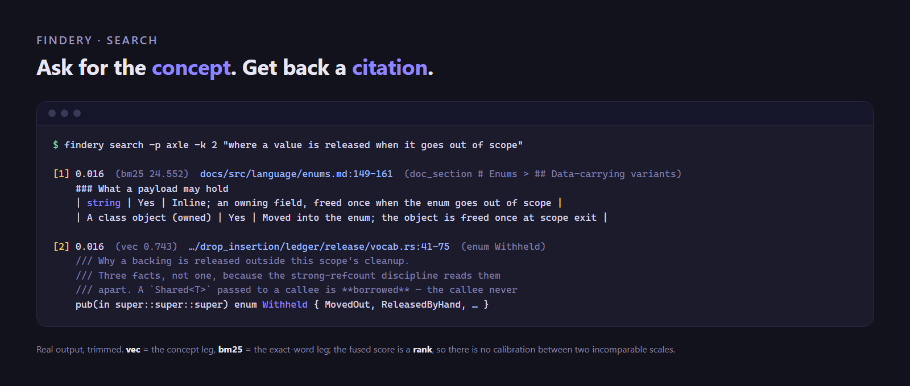
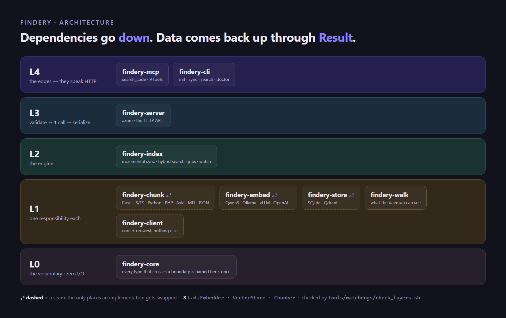

<div align="center">

# 🔎 findery

### A local semantic index of your codebases — so you, and your coding agent, find code by **what it does** instead of the word you guessed

**Not a grep wrapper, and not a cloud service.** One embedding model, loaded once in the background, serves every project and every client: a CLI, an HTTP API, a Rust client, and an MCP bridge that puts `search_code` into Claude Code. Locating one function in an unfamiliar repository usually costs a `glob`, three to six `grep` and three to eight `Read` — 25,000 to 60,000 input tokens. With findery it is one call, tens of milliseconds, and a citation.

<p align="center">
  
  
</p>
<p align="center">
  
  
  
  
</p>
<p align="center">
  
  
  
  
  
</p>



<sub>One question in plain words. Each hit is a `path:start-end` locator you can quote, the file to open, and the excerpt — here a doc section found by its words and a Rust enum found by its meaning.</sub>

<br>

<sub><a href="#-at-a-glance">At a glance</a> · <a href="#-highlights">Highlights</a> · <a href="#use-it">Use it</a> · <a href="#using-it-from-another-rust-project">From Rust</a> · <a href="#what-this-changes">What it saves</a> · <a href="#architecture">Architecture</a> · <a href="docs/getting-started.md">Getting started</a> · <a href="docs/deploying.md">Deploying</a> · <a href="CLAUDE.md">Contributing</a></sub>

</div>

---

> **findery** *(n.)* — a place where finding gets done. The model is warm, the index is yours, and a question
> in plain words comes back as a line number.

> **Status.** `0.3.x`: the engine, the CLI, the HTTP API and the MCP bridge run natively on Windows (an
> `.msi` ships) and in Docker. The suite is 475 tests under `clippy -D warnings`, with a watchdog
> on the layer law. Open work is in [`.claude/roadmap/`](.claude/roadmap/README.md), not hidden here.

## 📊 At a glance

| | |
|---|---|
| **Language** | 100% Rust — a five-layer workspace, one `findery` CLI, one `finderyd` daemon, one `findery-mcp` bridge |
| **Search** | Hybrid: vectors for the concept, BM25 for the exact identifier, fused by **rank** (RRF) — no calibration between two incomparable scales |
| **Chunking** | Syntactic, per item, with a symbol and a breadcrumb: **Rust, JavaScript / TypeScript, Python, PHP, Axle, Java, Kotlin, Go, Markdown, JSON**; line windows for everything else. No tree-sitter, no C toolchain — a lexical scanner that never mistakes a brace in a string for a structural one |
| **Cost model** | A vector is keyed by `(recipe, content_hash)`, never by place. An unchanged tree, a re-clone, a `--full` or a reordered file cost **zero embeddings** |
| **Model** | Nothing hardcoded: Qwen3 out of the box, any local runtime (Ollama, llama.cpp, LM Studio, vLLM), any remote provider. Backend, URL, route, auth header, name and width are data. Changing model opens a new space, it never mixes two |
| **Store** | Embedded SQLite — exact in-RAM scan, **12 ms at 50k chunks**, no service to run — or Qdrant (HNSW) beyond ~150k chunks. Switching re-embeds nothing |
| **Feeding it** | The daemon walks what it can see; a client walks what it cannot and pushes the contents. Same walk, same write path, so a container or another machine needs **nothing mounted** |
| **Failure** | A file that cannot be read becomes a `warning` in the sync report, never a silent skip. A recipe conflict is raised by the operation that would mix, never at boot — the daemon stays up to say so |
| **Verification** | `make check`: `fmt`, `clippy -D warnings`, 475 tests, `check_layers.sh` (the layer law), `check_file_size.sh` (≤ 450 lines of code per file). Performance claims are reproducible with `make bench` |
| **Exit** | Your vectors export as JSONL / JSON / raw `float32`. The bucket is the durable truth, the vector store is reconstructible from it |

---

## ✨ Highlights

- 🔍 **Hybrid search** — `"where is retrying handled"` and `"with_backoff"` both land, with no second index and no re-tuning.
- ⚡ **Re-syncing is free** — three gates (size and mtime, content hash, vector cache) make an unchanged repo cost zero embeddings; a re-sync after ten modified files takes seconds.
- 📡 **Works with nothing mounted** — the daemon reads your files, or the CLI reads them and pushes the contents: a container, another machine, any disk, no bind mounts.
- 🔒 **No lock-in on the model** — switch from a local Qwen3 to a hosted provider with `findery config set`; the environment still wins over the file, so one image serves every deployment.
- 🗄️ **A pluggable store** — SQLite until you outgrow it, Qdrant after; the numbers behind that threshold are measured and reproducible, including why an *embedded* ANN index was tried and ruled out.
- 🧭 **Scopes, not second indexes** — a `[scopes]` table in the project manifest names a restriction (`findery search --scope api "…"`) that filters the same index before scoring.
- 🩺 **`findery doctor`** — names what is missing and the command that fixes it, including a daemon older than the CLI.
- 🤖 **Nine MCP tools** — `search_code` becomes the agent's first reflex for locating code, in place of `glob` + `grep` + three `Read`.
- 🧱 **A layer law, checked by a script** — dependencies go down, data comes back up through `Result`, and the three swappable seams (`Embedder`, `VectorStore`, `Chunker`) are the only places an implementation changes.

> **New here?** [`docs/getting-started.md`](docs/getting-started.md) walks the
> whole setup step by step, with sizing tables and a troubleshooting section.
>
> **Handing it to a team?** [`docs/deploying.md`](docs/deploying.md).

---

## Use it

### 1. Install

```bash
git clone <this-repo> && cd findery
make install        # findery, finderyd, findery-mcp → ~/.cargo/bin
make up-model       # the Qwen3 model in Docker (~1.2 GB on first launch)
```

**On Windows**, where there is no `make`, the same task list is a PowerShell
script — same names, same commands:

```powershell
.\tools\tasks.ps1 install
.\tools\tasks.ps1 up-model
.\tools\tasks.ps1 help        # every task
```

**Without a Rust toolchain**, every release ships an installer — three binaries
in `Program Files`, `findery` on your `PATH`:

```powershell
# download findery-<version>-x64.msi from the latest release, then
msiexec /i findery-0.3.0-x64.msi
findery --version
```

**Already running a model?** Skip `make up-model`. Anything serving
`/v1/embeddings` fits — Ollama, llama.cpp, LM Studio, vLLM, or a hosted
provider:

```bash
findery config set url http://127.0.0.1:11434
findery config set model <the name that runtime reports>
```

More cases in [Choosing your model](#choosing-your-model).

### 2. Index a project, then search it

In **any project, on any disk**:

```bash
cd D:/work/my-project
findery init                              # registers the directory, writes .findery/config.toml
findery sync                              # indexes it, with a progress bar
findery search "where is retry handled"   # the project is read from the manifest
```

No path to type, no mount to declare, **and nothing to start** — the first command
brings the index up in the background and says nothing about it, because it is not
something you asked to manage. Nothing to keep open.

Each hit is a `path:start-end` locator you can quote, an absolute path you can
open, and the excerpt itself.

The first index of a large repository takes minutes; everything after is
incremental. Run `findery doctor` whenever something looks wrong: it names what
is missing and the command that fixes it.

`init` leaves two things behind in the project: the manifest below, and the
index itself, which lives inside the project by default. Both are yours; the
index is gitignored for you.

```toml
# .findery/config.toml
project = "my-project"

[bucket]
name = "my-project"
path = ".findery/bucket.db"

[scopes.api]
paths = ["crates/server/**"]
```

`init` and `sync` are two steps on purpose: a repository can be registered and
its bucket chosen **before** any model is reachable. `findery init --sync`
does both in one go when you are ready.

### 3. Hand it to Claude Code

`.mcp.json` at the root of the project to index:

```json
{
  "mcpServers": {
    "findery": {
      "command": "C:/Program Files/findery/findery-mcp.exe"
    }
  }
}
```

That is the path the installer produces:

- **From a source checkout** — `<repo>/target/release/findery-mcp`
- **From `make install`** — whatever `~/.cargo/bin` resolves to

Whichever you name, it must be the bridge from the same build as the server it
talks to.

Restart Claude Code, then `/mcp`: nine tools appear, `search_code` among them,
which becomes the agent's first reflex for locating code — in place of `glob` +
`grep` + three `Read`.

The bridge is launched by Claude Code rather than by your shell, so it takes its
daemon address from the `env` block of this file — add
`"env": { "FINDERY_SERVER_URL": "https://findery.internal.example.com" }` when
the daemon is not on loopback. Leave it out for a local one.

Details and the Docker variant: [`.claude/docs/mcp/README.md`](.claude/docs/mcp/README.md).

### Day to day

```bash
findery projects        # your projects, the current one marked with a *
findery status          # files, chunks, vectors
findery sync            # after coding — near instant
findery watch           # or let it resync on its own
findery search -p axle "retry"    # target another project from anywhere
findery search --scope api "where is the retry policy"   # a named restriction from the manifest
findery bucket ls      # the independent indexes it serves
```

### The two ways to run this

|                      | Native daemon *(default)*   | All in Docker                          |
|----------------------|-----------------------------|----------------------------------------|
| Commands             | `make up-model` + `findery` | `make up`                              |
| What's containerized | the model alone             | model + daemon                         |
| Who reads your files | the daemon                  | **the CLI, and pushes them**           |
| Indexable projects   | anywhere, any disk          | anywhere, any disk                     |
| Bind mounts          | none                        | none                                   |
| Watching             | background                  | `findery watch`, foreground            |
| Who it's for         | a dev machine               | a shared server, a CI, a remote daemon |

The daemon is a 5 MB Rust binary with an embedded SQLite — containerizing it
on a dev machine gains nothing and costs the mount boundary. What deserves
Docker is the model.

The all-Docker mode needs no mounts either: when the daemon cannot see a
directory, the CLI reads it and sends the contents.

That is also what lets the daemon live on **another machine** —
`findery config set server <url>` and index normally.

### Naming a daemon

The address lives in the same settings file as everything else, so a client
finds its daemon without an environment variable:

```bash
findery config set server https://findery.internal.example.com
findery config set token  <the bearer token it asks for>
```

Precedence, narrowest last:

1. `--server` / `--token`
2. `FINDERY_SERVER_URL` / `FINDERY_API_TOKEN`
3. the settings file
4. loopback

The environment stays on top so one container image can serve every
deployment. `findery config set` warns when a variable is masking what it just
wrote.

### Buckets — your index, and anyone else's

A **bucket** is one SQLite file holding everything the daemon knows about a set
of projects. **By default it lives inside the project**, at
`.findery/bucket.db`: the index travels with the code, and nothing is shared
that you did not ask to share.

A bucket becomes shared when two projects point at the *same file* — a team
index on a shared drive is one file and one name:

```toml
[bucket]
name = "team"
path = "D:/shared/team.db"
```

```bash
findery bucket ls                   # what each one holds, and its path
findery bucket rm work --force      # projects and vectors go with it
```

The choice is made once, at registration: every later command follows the
project, so nobody has to remember which index a directory belongs to.

A `[scopes]` table in the same manifest declares named restrictions a search can
ask for — `findery search --scope api "…"` — which filter the same index before
scoring, never a second one.

---

## Using it from another Rust project

```toml
[dependencies]
findery-client = { path = "../findery/crates/client" }
findery-core   = { path = "../findery/crates/core" }
```

```rust
use findery_client::Client;
use findery_core::{ids::ProjectId, model::SearchRequest};

let client = Client::from_env()?;              // FINDERY_SERVER_URL / FINDERY_API_TOKEN
let project = ProjectId::new("my-project")?;
for hit in client.search(&SearchRequest::new(project, "where is retry handled")).await? {
    println!("{}  {:.3}\n{}", hit.chunk.locator(), hit.score, hit.chunk.text);
}
```

`findery-client` only depends on `findery-core` and `reqwest`: no SQLite, no walker, no
chunkers.

---

## What this changes

Without an index, locating something in an unfamiliar codebase costs one
`glob`, three to six `grep` and three to eight `Read` — commonly **25,000 to
60,000 input tokens**. With `search_code`, the same question costs one call
and **2,500 to 3,500 tokens**; add the 0-2 targeted `Read` it sometimes needs
and you are at **3,000 to 9,000**, which is the column the table below prices.

Exploration typically accounts for 40 to 60% of the input tokens of an agent
session on a codebase it doesn't know. Cutting that share by ~70% gives a
**net gain on the order of 30 to 45% on the session**, and just as much
latency saved — which often matters more.

The assumptions and the full calculation are detailed just below in
[ESTIMATE](#estimate--gains-and-savings).

---

## ESTIMATE — gains and savings

> Orders of magnitude, with the assumptions stated. Recalibrate on your own
> sessions: `/cost` in Claude Code gives the real measurement.

### Cost of an exploration, without and with the index

|                   | Without an index             | With `search_code`           |
|-------------------|------------------------------|------------------------------|
| Tool calls        | 1 glob + 3-6 grep + 3-8 read | 1 search + 0-2 targeted read |
| Input tokens      | 25k – 60k                    | 3k – 9k                      |
| Round trips       | 8 – 15                       | 2 – 4                        |
| Perceived latency | 30 – 90 s                    | 3 – 8 s                      |

### Over a full session

Assuming exploration accounts for 50% of the input tokens of a work session
on an unfamiliar codebase, and that 70% of it is removed:

| Session            | Input without index | Input with index | Savings |
|--------------------|---------------------|------------------|---------|
| Short (1 question) | ~80k                | ~50k             | ~37%    |
| Medium (a feature) | ~500k               | ~325k            | ~35%    |
| Long (refactor)    | ~2M                 | ~1.3M            | ~35%    |

At **$5 / M input tokens** (Claude Opus 5, API pricing), an average session
goes from about $2.50 to $1.60 of input cost, i.e. **~$0.90 saved per
session**. Ten sessions a day, twenty days a month: **~$180/month** per
developer.

On a flat subscription, the gain isn't monetary but shows up in quota: that
many more sessions before hitting the limit.

Real side effect: fewer reads of never-before-seen files means a more stable
context prefix, hence a **better cache hit rate** — cached reads are billed
at 10% of the input rate.

### Productivity

The token savings aren't the main gain. What really changes:

- **Time to locate** drops from tens of seconds to a few seconds. Over
  20 to 40 lookups a day, that's 15 to 30 minutes.
- **First-try success rate** goes up: the agent finds semantically relevant
  code that a grep on the wrong keyword would have missed.
- **The context window stays useful longer**: fewer whole files swallowed,
  so fewer mid-task compactions.
- **The marginal cost of a new project is zero**: the model is already
  warm, indexing one more repo is a single command.

### Running cost

| Item                                | Order of magnitude                                   |
|-------------------------------------|------------------------------------------------------|
| First indexing, 500k lines, CPU     | 10 – 25 min                                          |
| Same, GPU                           | 1 – 3 min                                            |
| Re-sync, nothing changed            | < 1 s, **zero embeddings**                           |
| Re-sync after 10 modified files     | 2 – 10 s                                             |
| Daemon RAM, 50k chunks at 1024 dims | ~250 MB                                              |
| Disk, bucket + cache                | ~535 MB for 500k lines (~10.7 kB/chunk at 1024 dims) |
| Search latency                      | 15 – 60 ms                                           |

The break-even point is reached within a handful of sessions: a single
avoided exploration pays back several minutes of indexing.

---

## Architecture



<sub>The five layers and the three seams. Every arrow goes down; `tools/watchdogs/check_layers.sh` fails the build if one goes up.</sub>

```text
 L4   findery-mcp (MCP stdio)      findery-cli (`findery`)        the edges
 L3   findery-server (axum)                              HTTP transport
 L2   findery-index                                      sync, search, jobs, watch
 L1   findery-chunk   findery-embed   findery-store   findery-client    one responsibility each
 L0   findery-core                                       vocabulary, zero I/O
```

Dependencies flow down, data flows back up through `Result`. Verified by
`make layers`.

| Page | Contents |
|------|---------|
| [`usage/`](.claude/docs/usage/README.md) | every flag, every knob, and when to reach for it |
| [`overview/pipeline.md`](.claude/docs/overview/pipeline.md) | from file to cited hit |
| [`overview/layers.md`](.claude/docs/overview/layers.md) | the law of the layers |
| [`chunk/`](.claude/docs/chunk/README.md) | chunking per language, lexical scanner, merging |
| [`embed/`](.claude/docs/embed/README.md) | models, Qwen3 instruction, providers |
| [`store/`](.claude/docs/store/README.md) | bucket, backends, measurements, export |
| [`index/`](.claude/docs/index/README.md) | sync, hybrid search, jobs, watch |
| [`server/`](.claude/docs/server/README.md) | HTTP API reference |
| [`mcp/`](.claude/docs/mcp/README.md) | MCP tools and setup |

Two pages sit outside that set, written for readers rather than contributors:
[`docs/getting-started.md`](docs/getting-started.md) and
[`docs/deploying.md`](docs/deploying.md) — the latter for handing findery to a
team.

---

## Choosing your model

Nothing is hardcoded. `findery config set` writes the settings file the daemon
reads — same command as everywhere else on this page, so the choice survives the
terminal it was made in. Three cases:

```bash
# Local, provided (default)
findery config set model qwen3.7-text-embedding
findery config set dim   1024

# A local runtime you already have (Ollama, llama.cpp, LM Studio, vLLM…)
findery config set url   http://127.0.0.1:11434
findery config set model <the name that runtime reports>

# A remote provider
findery config set url   https://api.openai.com
findery config set model text-embedding-3-large
findery config set dim   3072
findery config set key   sk-...
```

Each of these also has a `FINDERY_EMBED_*` environment variable, and the
environment wins over the file, in the same order as `server` and `token`
above.

- `findery config show` prints what is set, secrets masked.
- `findery config set` warns when a variable is masking what it just wrote.

Changing `model` or `dim` opens a new cache namespace: the next `sync`
re-embeds.

---

## Choosing your vector store

```bash
findery config set store qdrant                        # sqlite by default
findery config set store.qdrant.url http://127.0.0.1:6333
```

| Backend | Search | Service | When |
|---------|-----------|---------|-------|
| `sqlite` (default) | exact in-RAM scan — **12 ms at 50k chunks**, 50 ms at 200k | none | up to ~150k chunks |
| `qdrant` | HNSW, filters, int8 quantization | a local container | beyond that, or a shared index |

The switch **re-embeds nothing**: the bucket does not move, every vector is
already in the content-addressed cache, and the next `sync` fills the new store
from it.

The numbers are reproducible: `make bench`. The full reasoning — including why
an **embedded** ANN index was measured and then ruled out — is in
[`.claude/docs/store/README.md`](.claude/docs/store/README.md).

---

## Development

```bash
make check     # fmt-check + clippy -D warnings + test + layers + sizes
make test      # 475 tests
make bench     # vector scan measurement
```

Windows: `.\tools\tasks.ps1 check` — it needs Git for Windows, because the two
watchdogs are shell scripts and it finds that bash rather than WSL's.

- **The repo's rules** — [`.claude/rules/CONVENTIONS.md`](.claude/rules/CONVENTIONS.md)
- **Open work** — [`.claude/roadmap/README.md`](.claude/roadmap/README.md)

---

## License

MIT OR Apache-2.0
